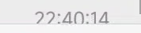
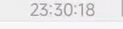

# 消息时间：通话记录与聊天末尾验收

本轮基线为 `94f9f99`，保留现有功能及工作区原有未跟踪文件。设备为 Redmi K50 Ultra（22081212C）、Android 15，正式安装的微信 `com.tencent.mm` 8.0.80（versionCode 3220）。没有卸载微信或清除数据，也没有发起真实通话；测试消息发往文件传输助手。

## 根因和处理

- `MessageDetailsVisibility` 原来明确排除了 `50、52、53、1000052、1000053`。现在它们复用消息自身 `createTime`、现有格式、颜色与位置流程。系统、拍一拍及撤回等既有排除项保留。
- 微信 8.0.80 的实际通话样本中，语音未接通、视频未接通和视频中断均是 `RelativeLayout` 消息行，具有真实头像分支。移除类型排除后，试验包和最终正式包中三条记录的头像下方出现时间；相邻系统提示仍无额外标签。其他通话结果及设备版本不能仅由这三个样本推断。
- 无键盘时，实测聊天 `RecyclerView` 的屏幕下沿为 2493px；正常消息的时间标签是消息行的直接子项，下沿为 2475px。基线发送录屏中，最新标签在进入列表时曾越过 2493px 边界而被输入栏截断，随后完整露出；这不是标签自身字体高度不足。基线 6 次键盘关闭短文字发送的稳定画面均完整，但逐帧录屏复现了短暂裁切。
- 真机诊断发现外层聊天 Adapter 包含头部结构行：例如内部绑定位置 16 对应外层实际位置 17，总数 18。原代码要求两种位置相等，导致尾部资格确认始终返回空；外层 Adapter 的实际位置 17 能读取对应原生消息，身份匹配且为最后一条。现在以外层可见行位置和外层 Adapter 数据核验消息身份及最新资格，再以绑定代次、位置、附着状态、开关和跟随意图复核；不把未知行推断为 footer。
- 跟随意图在宿主绑定或可见行补绑导致扩高之前尽早登记；已有登记不会被后续 `canScrollVertically(1)` 的变化重置。无法取得更早底部证据且首次观察已经可向下滚动时仍保守地不猜测用户意图，避免把历史阅读位置拉回末尾。
- 旧的行检查 `post()` 再接注册表 `post()` 已收敛为布局后的预绘制检查。最新行即使首次无溢出也会保留几何观察；行、标签、列表及祖先可视区域或底部 padding 变化触发合并检查。绘制位置与实际可视矩形统一按窗口坐标计算并包含宿主变换，避免分屏或悬浮窗口的屏幕偏移造成误判；模拟窗口偏移回归先在旧代码失败、修复后通过。
- 对正由微信原生滚动带入的新消息，时间标签完全在视口外时先让原生动画继续；标签即将进入时在预绘制阶段只修正必要距离。等待期间只观察已确认的单个最新行，并随原生滚动结束、绑定变更或页面清理停止；主动续排最多 90 次，后续真实滚动或状态变化仍可触发检查。若宿主没有继续滚动，则在一个绘制周期后处理，避免永久遗漏。诊断包 5 次键盘关闭发送中，实际补偿为 29–30px；逐帧抽查显示时间首次出现时完整。诊断日志和试验包不属于交付物。
- 间距为 0 时，设备测得头像 View 下沿和时间标签 View 上沿均为 2443px，布局间距已经为 0；截图中剩余视觉空白来自头像图片内部透明区域及字形留白，没有引入负 margin、裁剪或字体缩小。

## 构建和自动回归

- Android 单测：175 项，0 失败、0 错误。生产路径回归包括外层头部位置、Adapter 项身份和新消息资格、真实通话创建时间、逐阶段预绘制、行高增长、窗口偏移、视口和祖先裁切、用户历史、A→B、禁用及队列清理。变换计算也在 API 27 Robolectric 环境下执行，不依赖 API 29 才提供的矩阵转换方法。
- 消息时间绑定、布局、预绘制、消息类型、消息解析、性能、Native、API 102 与 HookRegistry 相关脚本通过。消息类型 96 项、消息解析 153 项。
- `:app:lintRelease`：0 errors、655 warnings、50 hints。`:app:assembleRelease` 完成正式签名 R8 构建；APK v2 签名验证通过，签名证书与安装前版本一致。API 102 APK 校验通过。

## 最终正式包真机验收

- 用 `adb install -r` 安装最终 APK，设备上 APK 的 SHA-256 与交付文件一致。测试在微信正式安装环境进行，没有卸载微信或清除数据；文件传输助手保留本轮生成的测试消息。
- 头像下方、间距 0、输入栏可见：键盘关闭连续发送 10 条短文字，键盘打开连续发送 10 条短文字。最终 APK 两轮均录屏，分别取得 806 和 773 帧；对录屏逐帧进行时间 OCR 和列表底部像素检查，对每条新时间首次被识别之前的 4 帧及首次识别帧制作联系表目视检查。捕获的画面未发现时间先露出半截再补齐，也未观察到明显停顿后第二次跳动。录屏并不保证包含设备显示的每一帧，OCR 与样本量也有局限，不能据此宣称偶发问题已彻底消除。
- 下方两张图片只保留时间文字与输入栏边界的小范围原始裁切：前者为基线录屏第 7.37 秒，后者为最终包录屏中 `23:30:18` 首次被识别的第 1.525 秒。图片不包含头像或消息正文，完整录屏为临时诊断文件，不提交。

  基线裁切：

  最终包首次可见：

- 关闭键盘时，最新时间标签下沿为 2475px，列表实际可视下沿为 2493px；打开键盘时，最新时间标签下沿为 1480px，列表实际可视下沿为 1498px。稳定画面中 20 条时间均完整。
- 最终 APK 发送一条长文本和一条约 2 秒语音；退出重进后其本地消息时间可见。语音发送录屏取得 445 帧，时间首次被识别前后的 5 帧中时间完整。图片消息由此前的候选包发送，最终包重进并滑到该消息后可见完整时间，图片可点击打开查看器；微信对图片显示“重发”，因此图片成功上传或送达 **NOT_VERIFIED**。长文本和图片发送过程没有完成针对时间的逐帧验收。
- 向历史滑动后，12 条可见测试消息在间隔超过 4 秒的两次 UI 层级采样中坐标完全一致，没有被模块拉回底部。该滑动过程中微信自行收起了键盘；历史位置直接聚焦输入框后的宿主定位与模块行为未作归因。
- 用设置页关闭消息时间并保存，重进聊天及滚动历史后未发现时间标签；重新开启并保存，重进后时间恢复。测试前后的 `Hchat_global_config.kva/.kvb` 和 `Hchat_extra_config.kva/.kvb` 均逐项 SHA-256 相同。
- 最终包中的三条已有通话记录时间分别为 `22:30:45`、`22:31:16`、`22:31:17`，均位于对应消息行头像下方；其他语音、视频通话结果和来电/去电组合未覆盖，也没有为测试而拨打联系人。

## 交付与未验证边界

- 正式签名 APK：`dist/Hchat-1.2.1-message-time-release-signed.apk`；SHA-256：`67a1658753c98dc1d2a28b1c5bb68105301f031f3c99eb83764cf6475b2cc853`。
- 对短消息录屏样本，最终显示及捕获帧内的裁切/明显补跳检查通过；其他设备、微信版本、实机分屏/悬浮窗口、全部消息类型、长时间压力以及录屏可能漏掉的帧尚未验证。设备未安装 `com.tencent.mm.wx`。
- 若首次观察列表时没有此前的底部状态证据、列表又已经可以向下滚动，仍保守保留当前位置；这种模糊情况下不保证自动补齐，以避免误把用户从历史拉回。若宿主滚动状态长期异常停在 SETTLING，主动逐帧观察最多 90 次，之后依赖真实滚动或状态变化再次触发。
